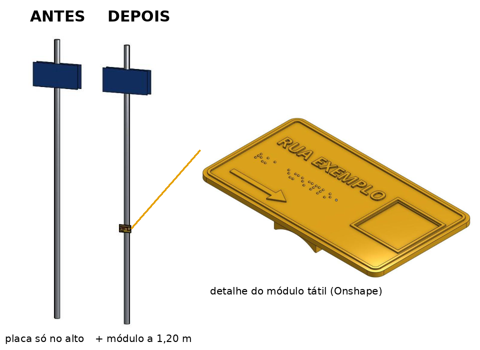
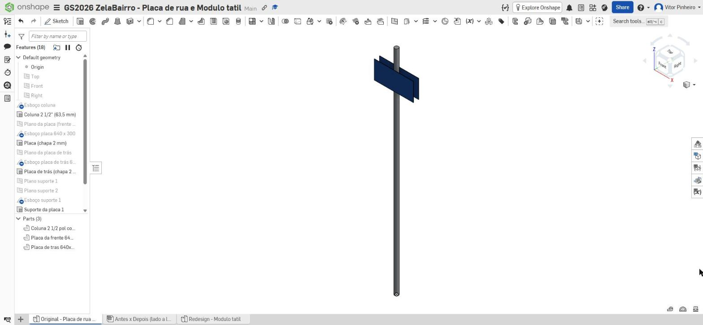
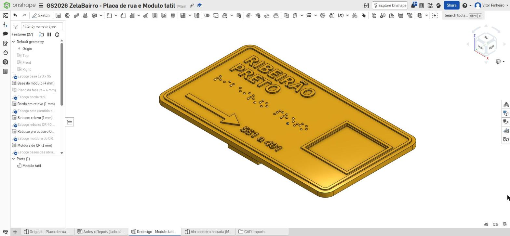
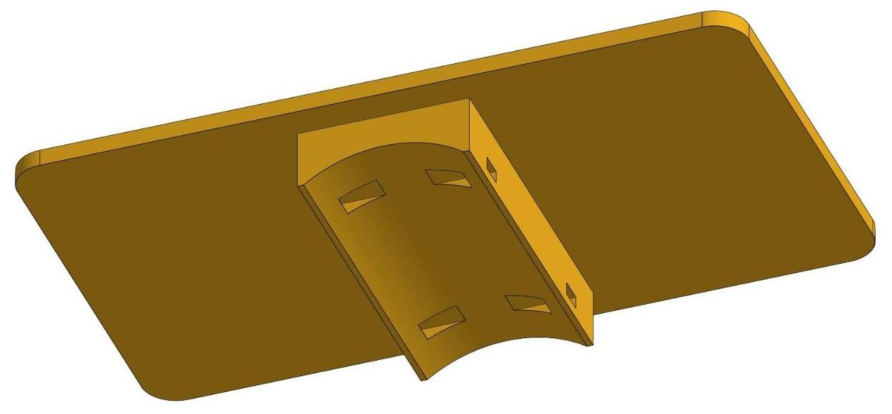

# ZelaBairro - Módulo tátil para placa de rua

Global Solution 2026.2 (CitizenTech) - FIAP, Engenharia de Software 4ESPA
Disciplina: Project-Based Maker Lab - Profª Thais Aparecida Fernandes Kabuchi

Página do projeto: https://vitorpnascimento.github.io/GS2026-ZelaBairro-MakerLab/

## O problema

A placa de nome de rua (padrão CET-SP, 64 x 30 cm) fica no alto, acima de 2,10 m, e só tem informação visual. Quem é cego ou tem baixa visão não consegue saber em que rua está, e quando a placa está apagada ou torta não tem um jeito simples de avisar alguém.

## A proposta

Um módulo pequeno (170 x 95 mm) preso na mesma coluna da placa, na altura da mão (1,20 m), com:

- nome da rua em relevo (1 mm) e em braille logo abaixo
- seta em relevo indicando o sentido da numeração
- rebaixo de 40 x 40 mm para um adesivo de QR code que abre o registro de ocorrência no ZelaBairro
- borda e cantos arredondados
- sela atrás para a coluna de 2 1/2" (63,5 mm), presa sem furar nada

A placa original continua no lugar. O módulo só acrescenta a informação tátil e o acesso ao ZelaBairro.

## Antes e depois

## Modelos (Onshape)

| Original | Redesign |
|---|---|
|  |  |

Parte de trás do módulo (encaixe na coluna e passagens da abraçadeira):

## Arquivos

- `CAD/Original/` - coluna com as placas (STEP e STL)
- `CAD/Redesign/` - módulo tátil (STEP e STL, pronto pra imprimir)
- `Imagens/` - prints do Onshape e comparação

Impressão sugerida: PLA ou PETG, camada 0,2 mm, 3 paredes, 20% de preenchimento, face do texto pra cima, sem suporte.

## Peça baixada (crédito)

Abraçadeira usada na fixação: "BRACE PVC PIPE CLAMPS with hinge (DN50, 63mm, etc)", de Mihai B Mike, licença CC BY-NC-SA. Ajustada no Parametric Model Maker para a coluna de 63,5 mm.
https://makerworld.com/models/1781504

## ODS

- ODS 11 - Cidades e Comunidades Sustentáveis
- ODS 10 - Redução das Desigualdades

## Integrantes

- Gabriel Leão da Silva - RM552642
- Matheus Farias - RM554254
- Miguel Mauricio Parrado Patarroyo - RM554007
- Pedro Chaves - RM553988
- Vitor Pinheiro Nascimento - RM553693
